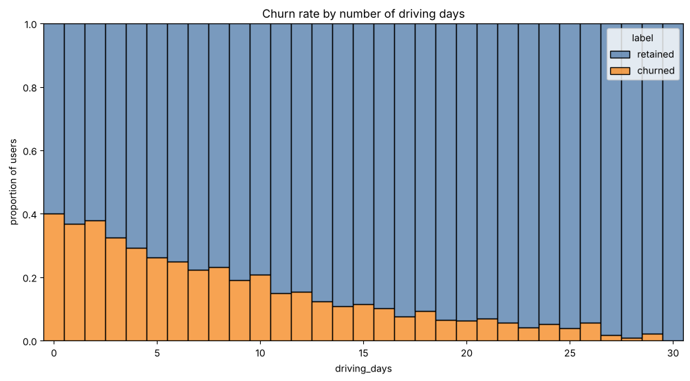
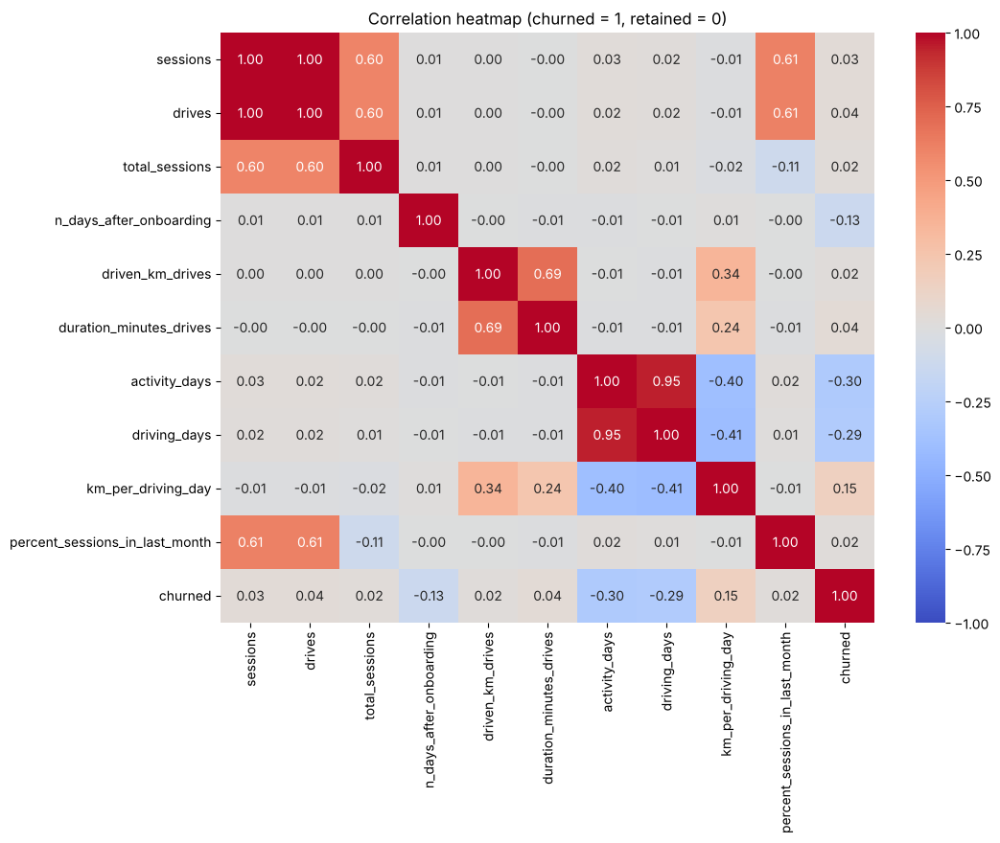
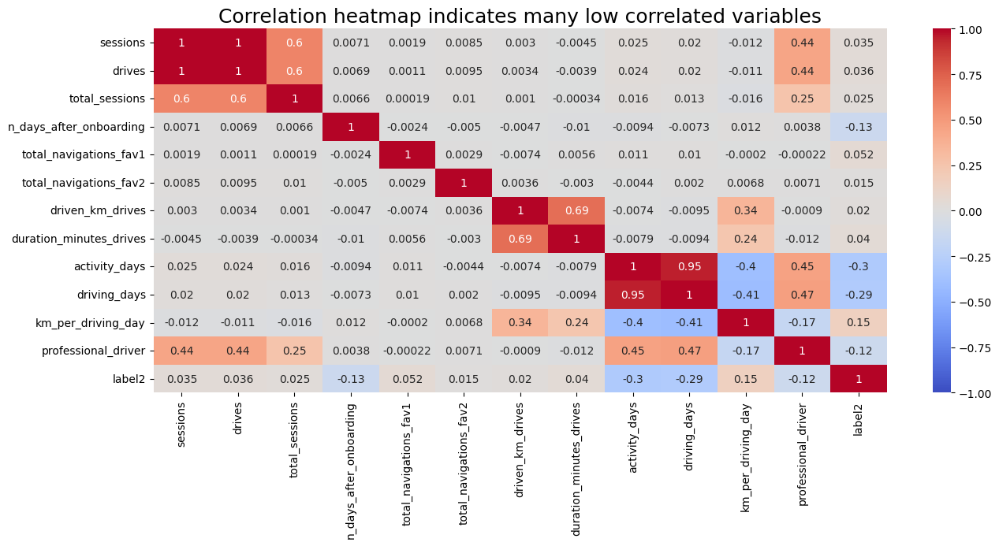
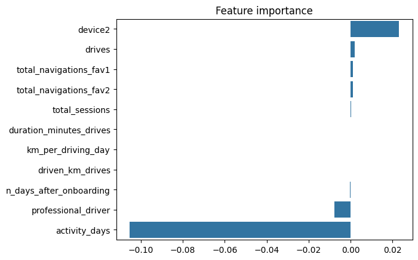
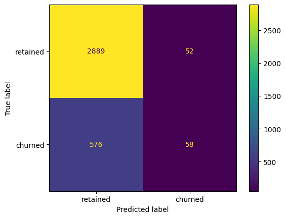

# 🚗 Waze User Churn Prediction

**An end-to-end data analytics project: from raw data to a churn-prediction model, built with Python and the PACE framework.**


This is the capstone project of the **Google Advanced Data Analytics Professional Certificate** (Coursera). Playing the role of a data analyst on the Waze data team, I explored a dataset of ~15,000 app users, tested hypotheses, and built regression and machine-learning models to understand and predict **which users are likely to stop using the app (churn)**.

The project was completed in five stages (one notebook per stage). Each stage is documented in the [PACE strategy document](docs/PACE_strategy_document.md).

---

## 📌 Business problem

Waze leadership wants to **reduce user churn**. To do that, the data team needs to answer:

1. Who are the users, and what does their behaviour look like?
2. Which behaviours are associated with churn?
3. Can churn be predicted accurately enough to act on?

## 🔑 Key findings

| Area | Finding |
|---|---|
| **Churn rate** | ≈ **17.7%** of labeled users churned (≈ 82% retained), and the rate is almost identical on iPhone and Android |
| **Strongest signal** | The more days a user drove in the last month, the **less likely** they were to churn. Very long distances per driving day are linked to **higher** churn |
| **Hypothesis test** | No statistically significant difference in average drives between iPhone and Android users (Welch's t-test, **p ≈ 0.14**) |
| **Logistic regression** | Accuracy ≈ 82%, precision ≈ 53%, but **recall only ≈ 9%**: accuracy is misleading on an 82/18 imbalanced target |
| **Tree-based models** | Random forest and XGBoost (tuned on recall) use many more features and improve recall, but still miss most churners |
| **Recommendation** | Use the model only as a **supplementary signal**, not a stand-alone decision tool, until it is improved with better features, class-imbalance handling and richer data |
| **Data quality** | 700 missing labels, physically impossible distances (up to ≈ 15,400 km/day) and inconsistent day counts should be raised with the data owners |

### Selected visuals

<p align="center">
  
  
</p>
<p align="center">
  
  
</p>
<p align="center">
  
</p>

---

## 📂 Repository structure

```
waze-user-churn-prediction/
├── README.md
├── requirements.txt
├── LICENSE
├── .gitignore
├── data/
│   └── waze_dataset.csv                      # 14,999 users × 13 columns
├── notebooks/
│   ├── 01_foundations_data_exploration.ipynb # Course 1 – data understanding & cleaning prep
│   ├── 02_eda_and_visualization.ipynb        # Course 2 – EDA & data visualisation
│   ├── 03_hypothesis_testing.ipynb           # Course 3 – statistics & hypothesis testing
│   ├── 04_regression_modeling.ipynb          # Course 4 – logistic regression
│   └── 05_machine_learning.ipynb             # Course 5 – random forest & XGBoost
├── scripts/                                  # helper scripts (re-run notebook 05, push to GitHub)
├── docs/
│   └── PACE_strategy_document.md             # PACE decisions, findings & reflections
└── images/                                   # figures used in this README
```

## 🧭 Project walkthrough

| # | Notebook | What I did | Skills shown |
|---|---|---|---|
| 1 | [Foundations of Data Science](notebooks/01_foundations_data_exploration.ipynb) | Inspected structure, missing values and group differences; created first engineered features | pandas, data inspection, feature creation |
| 2 | [EDA & Visualisation](notebooks/02_eda_and_visualization.ipynb) | Box plots, histograms and comparisons for every variable; found outliers and data problems | matplotlib, seaborn, storytelling with data |
| 3 | [Hypothesis Testing](notebooks/03_hypothesis_testing.ipynb) | Two-sample Welch's t-test: do iPhone and Android users drive a different amount? | SciPy, statistical inference |
| 4 | [Regression Modeling](notebooks/04_regression_modeling.ipynb) | Feature engineering, outlier handling, multicollinearity checks, binomial logistic regression | scikit-learn, model assumptions, evaluation |
| 5 | [Machine Learning](notebooks/05_machine_learning.ipynb) | Train/validation/test split, tuned random forest and XGBoost with grid search, champion model selection | GridSearchCV, XGBoost, model selection |

## 🗂️ Dataset

`data/waze_dataset.csv` — 14,999 rows, one per user, provided as part of the Google Advanced Data Analytics Certificate.

| Column | Description |
|---|---|
| `ID` | User identifier |
| `label` | Target: `retained` or `churned` (700 values missing) |
| `sessions`, `drives` | App sessions and drives in the last month |
| `total_sessions` | Estimated total sessions since onboarding |
| `n_days_after_onboarding` | Days since the user signed up |
| `total_navigations_fav1`, `total_navigations_fav2` | Navigations to the user's two most-used saved places |
| `driven_km_drives`, `duration_minutes_drives` | Distance (km) and time (min) driven in the last month |
| `activity_days`, `driving_days` | Days the user used the app / drove in the last month |
| `device` | `iPhone` or `Android` |

## 🛠️ Tech stack

Python · pandas · NumPy · matplotlib · seaborn · SciPy · scikit-learn · XGBoost · Jupyter

## ▶️ How to run

```bash
# 1. Clone the repository
git clone https://github.com/<your-username>/waze-user-churn-prediction.git
cd waze-user-churn-prediction

# 2. (Optional) create a virtual environment
python -m venv venv
source venv/bin/activate        # Windows: venv\Scripts\activate

# 3. Install dependencies
pip install -r requirements.txt

# 4. Launch Jupyter and open any notebook in /notebooks
jupyter notebook
```

All notebooks read the data with the relative path `../data/waze_dataset.csv`, so run them from inside the `notebooks/` folder (Jupyter does this by default when launched from the repo root and opened from there).

## 🔭 Limitations & next steps

- The model's recall for churned users is low, so it is not ready to drive retention campaigns on its own.
- Next: wider hyperparameter search (e.g. `scale_pos_weight`), class weights / resampling (SMOTE), decision-threshold tuning to favour recall, and additional models (LightGBM).
- Richer data would help most: month-by-month usage history, app crash logs, support contacts, tenure and region.

## 👤 Author

**Sumit Gawande** 

